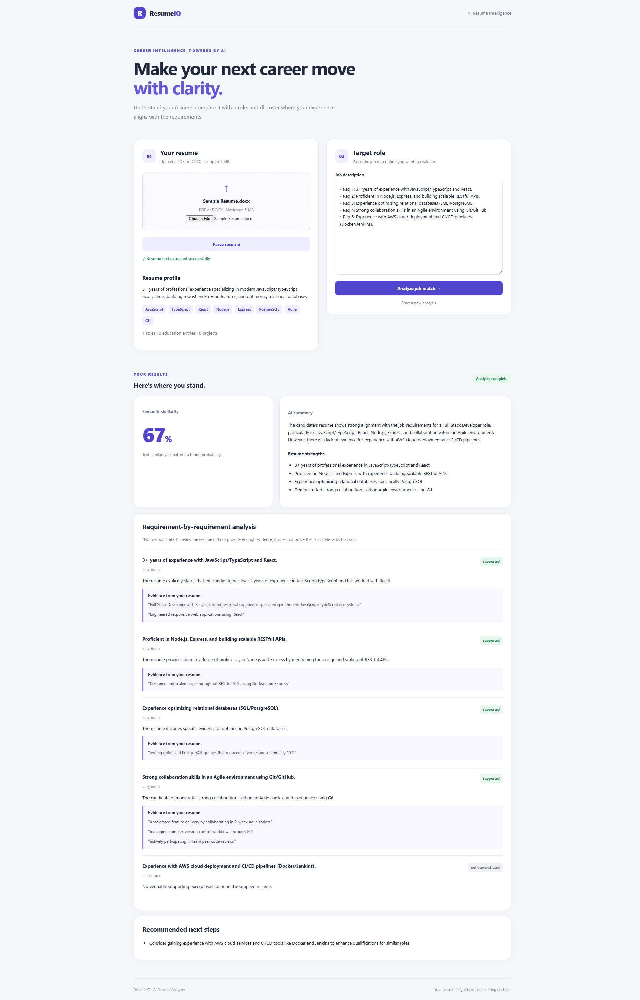
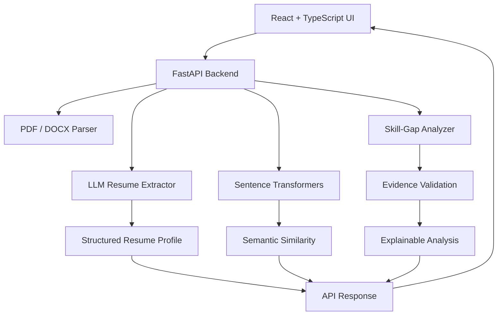

# AI Resume Analyzer

An AI-powered application that analyzes resumes against job descriptions, extracts structured candidate profiles, measures semantic similarity, and provides evidence-based skill-gap analysis.

Built to explore practical AI engineering patterns, including structured LLM outputs, embedding-based similarity, evidence validation, automated testing, and containerized application development.

## Application Preview



## Features

- **Resume parsing:** Extract text from PDF and DOCX files.
- **Structured information extraction:** Use an LLM to transform resume text into structured candidate profiles.
- **Semantic matching:** Compare resumes and job descriptions using Sentence Transformers.
- **Explainable skill-gap analysis:** Identify job requirements, classify supporting evidence, and suggest areas for improvement.
- **Evidence validation:** Validate quoted excerpts against the supplied resume text.
- **Interactive dashboard:** Review analysis results through a React and TypeScript frontend.
- **Automated testing:** Test backend endpoints, evidence validation, and frontend behavior.
- **Containerization:** Run the backend and frontend using Docker.
- **Continuous integration:** Run automated checks through GitHub Actions.

## Architecture



### Technology stack

| Layer | Technologies |
|---|---|
| Frontend | React, TypeScript, Vite |
| Backend | Python, FastAPI, Pydantic |
| Document processing | PyMuPDF, python-docx |
| LLM integration | OpenAI API, structured outputs |
| Embeddings | Sentence Transformers, all-MiniLM-L6-v2 |
| Testing | pytest, HTTPX, Vitest, React Testing Library |
| Containers | Docker, Docker Compose |
| CI | GitHub Actions |

## How it works

### 1. Resume parsing

The backend accepts supported PDF and DOCX files, extracts readable text, and applies input-size and content validation.

### 2. Structured resume extraction

The extracted text is sent to an LLM to produce a structured candidate profile containing relevant information such as skills, work experience, education, and projects.

### 3. Semantic matching

The application generates embeddings for the resume and job description using the same Sentence Transformers model and calculates cosine similarity.

The similarity score is a semantic comparison signal. It is **not a probability of getting hired or a calibrated measure of candidate suitability**.

### 4. Explainable skill-gap analysis

The LLM identifies job requirements and classifies the evidence found in the resume.

The application validates quoted evidence against the original resume text and rejects unsupported excerpts. A missing demonstration is not proof that the candidate lacks the skill.

## Project structure

```text
AI-Resume-Analyzer/
├── app/
│   ├── main.py
│   ├── config.py
│   ├── schemas/
│   └── services/
├── tests/
├── frontend/
│   ├── src/
│   ├── package.json
│   └── Dockerfile
├── Dockerfile.backend
├── docker-compose.yml
├── requirements.txt
├── .gitignore
└── README.md
```

*Adjust this structure to match the actual files in the repository.*

## Getting started

### Prerequisites

- Python version compatible with the installed backend dependencies
- Node.js and npm
- An OpenAI API key for LLM-powered functionality
- Docker Desktop, if using the containerized setup

### Backend setup

From the project root, create and activate a virtual environment.

**Windows PowerShell:**

```powershell
python -m venv .venv
.\.venv\Scripts\Activate.ps1
pip install -r requirements.txt
```

Configure the backend environment using the settings expected by `app/config.py`. Keep the API key out of source control.

For example:

```dotenv
OPENAI_API_KEY=your_api_key_here
OPENAI_MODEL=gpt-4o-mini
```

Save these values in the environment file location configured by the application.

Start the API:

```powershell
uvicorn app.main:app --reload
```

API documentation:

- Swagger UI: http://localhost:8000/docs
- Health endpoint: http://localhost:8000/health

### Frontend setup

Open another terminal:

```powershell
cd frontend
npm ci
npm run dev
```

Configure `VITE_API_BASE_URL` to point to the backend, using the frontend's expected environment configuration.

Open the local URL printed by Vite, normally http://localhost:5173.

### Docker setup

From the project root, configure the backend environment and run:

```powershell
docker compose up --build
```

With the supplied Compose port mappings, the frontend is available at http://localhost:8080 and the backend at http://localhost:8000.

Stop the containers with:

```powershell
docker compose down
```

The frontend build embeds its API base URL. If the application is accessed from another machine, `localhost` will refer to that machine rather than your development computer; configure the appropriate reachable API address.

## API endpoints

| Method | Endpoint | Purpose |
|---|---|---|
| GET | `/health` | Check backend health |
| POST | `/api/v1/resumes/parse` | Extract text from a resume file |
| POST | `/api/v1/job-descriptions/parse` | Validate and process job-description text |
| POST | `/api/v1/resumes/extract` | Extract a structured resume profile |
| POST | `/api/v1/resumes/match` | Calculate semantic similarity |
| POST | `/api/v1/resumes/skill-gap-analysis` | Generate an explainable skill-gap analysis |

See `/docs` for request schemas and response formats.

## Testing

### Backend

From the project root:

```powershell
pytest -q
```

Backend tests cover the API, document processing, evidence validation, and mocked AI-dependent behavior.

### Frontend

From the frontend directory:

```powershell
npm test
npm run build
```

### Continuous integration

GitHub Actions runs the configured backend tests, frontend tests, and frontend build on pushes and pull requests.

Tests should not require paid LLM API calls when AI dependencies are properly mocked.

## Security and privacy

- API keys are kept in backend configuration and must never be exposed through frontend environment variables.
- Environment files containing secrets are excluded from source control.
- File uploads and request text are subject to application validation limits.
- Resume contents and personally identifiable information should not be written to application logs.
- Resume text sent to an external AI provider is subject to that provider's data-handling terms.
- Use synthetic or appropriately authorized sample data for development and demonstrations.

## Limitations

- Extracted information and LLM-generated explanations may contain errors.
- Evidence matching verifies that excerpts appear in the resume; it does not independently prove every semantic claim.
- Scanned PDFs may require OCR, which is not included unless separately implemented.
- Semantic similarity is not a hiring probability.
- The application is a portfolio project, not a validated hiring decision system.

## Engineering goals

This project explores how to combine traditional software engineering practices with AI-specific design considerations:

- Typed API contracts and structured LLM outputs
- Embedding-based semantic retrieval
- Explainable, evidence-grounded responses
- Input validation and error handling
- Automated testing and continuous integration
- Reproducible local execution through containers

## Future improvements

Potential extensions include a repeatable AI evaluation suite, prompt-injection robustness tests, model comparison, OCR support, and retrieval-augmented generation where appropriate.

## Author

Full-stack software engineer transitioning into AI engineering, building practical applications that combine backend engineering, modern web development, and LLM-based systems.
